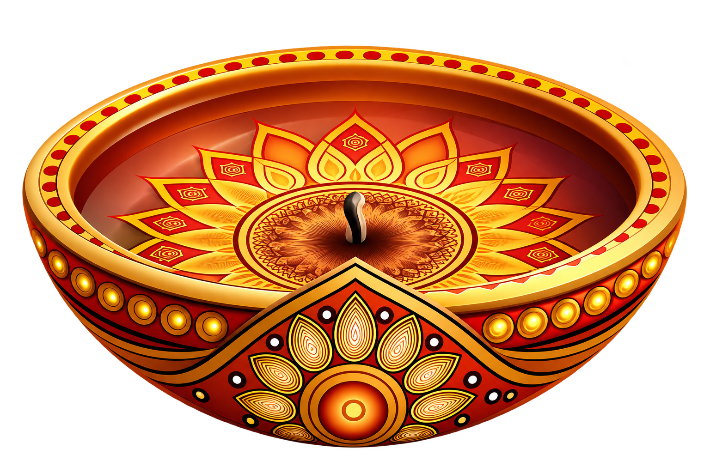

# 🪔 Mitti Se Diya — Handcrafted 3D Sacred Pottery

An interactive, high-fidelity 3D pottery simulation built with **React 19**, **Three.js**, and **React Three Fiber**. Experience the ancient Indian tradition of shaping raw wet earth (*mitti*) on a rotating pottery wheel into a sacred, beautifully sculpted Diya.



---

## ✨ Features

- 🏺 **Interactive 3D Pottery Wheel**: Realistic rotating clay mound responding dynamically to touch gestures and mouse interactions.
- 🖐️ **Continuous Clay Sculpting**: Real-time procedural vertex deformation simulating hollow-forming, wall-raising, and pinching the spout.
- 🔥 **Sacred Kiln Firing**: 5-second kiln firing stage transforming pliable raw clay into terracotta with authentic glow, smoke particles, and ambient kiln sounds.
- 🎨 **Traditional Indian Artistry**: Handcrafted floral petals, beaded trim, and golden studs matching traditional Indian earthen diya designs.
- 🪔 **Final Reveal & Showcase**:
  - Dramatic 360° showcase spin, settling at an optimal viewing angle.
  - Interactive sacred flame particle system with warm flickering point light.
  - Interactive OrbitControls for 360° inspection and zooming.
- 📱 **Mobile-First Responsive Design**: Optimized UI layouts, custom touch controls, dynamic viewport scaling, and gyroscope tilt parallax.
- 📸 **Snapshot & Sharing**: Capture high-resolution screenshots with confetti celebration and download options.
- 🎵 **Procedural Audio Synthesizer**: Web Audio API ambient sounds for the spinning wheel, clay squelch, kiln crackle, and flame hum without heavy audio assets.

---

## 🛠️ Tech Stack

- **Framework**: [React 19](https://react.dev/) + [Vite](https://vitejs.dev/)
- **3D Graphics & Physics**: [Three.js](https://threejs.org/) & [@react-three/fiber](https://r3f.docs.pmnd.rs/)
- **3D Helpers & Camera**: [@react-three/drei](https://github.com/pmndrs/drei)
- **Icons**: [Lucide React](https://lucide.dev/)
- **Celebration Effects**: [canvas-confetti](https://www.npmjs.com/package/canvas-confetti)
- **Language**: [TypeScript](https://www.typescriptlang.org/) (Strict Mode)

---

## 🚀 Getting Started Locally

### Prerequisites

Ensure you have [Node.js](https://nodejs.org/) (v18 or higher) installed.

### Installation

```bash
# Clone the repository
git clone https://github.com/cosmickdd/diya-pottery.git

# Navigate into the project directory
cd diya-pottery

# Install dependencies
npm install

# Start the local development server
npm run dev
```

Open [http://localhost:5173](http://localhost:5173) in your browser to experience the simulation.

### Production Build

```bash
# Type-check and create production build
npm run build

# Preview production build locally
npm run preview
```

---

## 🚢 Deploying to Vercel

### Method 1: Deploy via GitHub (Recommended)

1. Push your repository to GitHub (see [Pushing to GitHub](#-pushing-to-github)).
2. Go to [Vercel Dashboard](https://vercel.com/dashboard).
3. Click **"Add New..."** > **"Project"**.
4. Import your **`diya-pottery`** repository.
5. Vercel automatically detects the Vite configuration:
   - **Framework Preset**: `Vite`
   - **Build Command**: `npm run build`
   - **Output Directory**: `dist`
6. Click **Deploy**. Your 3D Diya application will be live in seconds!

### Method 2: Deploy via Vercel CLI

```bash
# Install Vercel CLI globally (if not already installed)
npm install -g vercel

# Deploy directly from terminal
vercel
```

---

## 📦 Pushing to GitHub

Run the following commands in your terminal:

```bash
# 1. Initialize git (if not already initialized)
git init

# 2. Stage all files
git add .

# 3. Create your initial commit
git commit -m "feat: complete 3D interactive sacred Diya pottery experience"

# 4. Set default branch to main
git branch -M main

# 5. Link your GitHub remote repository (replace with your repo URL)
git remote add origin https://github.com/cosmickdd/diya-pottery.git

# 6. Push your code
git push -u origin main
```

---

## 📄 License

MIT License. Crafted with reverence for Indian heritage and traditional pottery arts.
